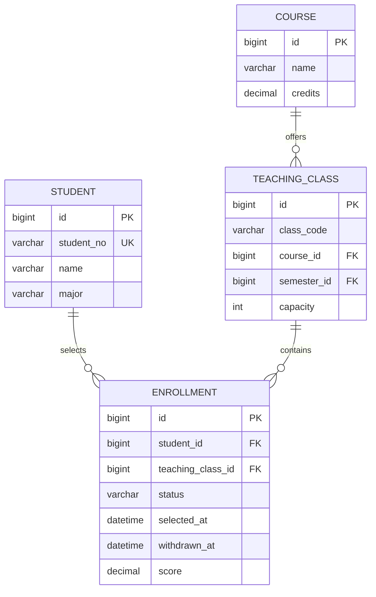

# 成员A概念结构设计

学生和教学班存在多对多联系，enrollment承载选课状态、成绩和最近选退课时间。一个学生可有0至多条选课记录，一个教学班可有0至多条记录；每条选课记录恰好对应一个学生和一个教学班。教学班实体由C负责，课程实体由B负责。

| 实体或联系 | 属性 | 候选标识 | 依据 |
|---|---|---|---|
| 学生 | 学生ID、学号、姓名、专业 | 学生ID；学号 | 学号在本版本全校唯一；姓名和专业不唯一 |
| 教学班（外部） | 教学班ID、教学班代码、课程ID、学期ID、容量 | A仅依赖ID唯一；其他由C定义 | 一门课程可以开多个教学班，选课对象是班 |
| 选课联系 | 记录ID、学生ID、教学班ID、状态、选课时间、退课时间、成绩 | 记录ID；学生ID与教学班ID组合 | 一对学生/班保留一条当前关系，不是完整事件历史 |

专业是本版本中的原子文本属性，不额外存储专业代码、学院或负责人；如果未来加入这些属性，应重新分析专业实体及函数依赖。成绩属于学生与教学班的联系，不能放在student或course表。姓名、课程名称不复制到enrollment，避免更新不一致。

此图是A模块和必要外部依赖片段，C需汇总教师、学期等实体形成全组E-R图。概念层的学生—教学班M:N联系在逻辑层转成enrollment及两条1:N联系。
