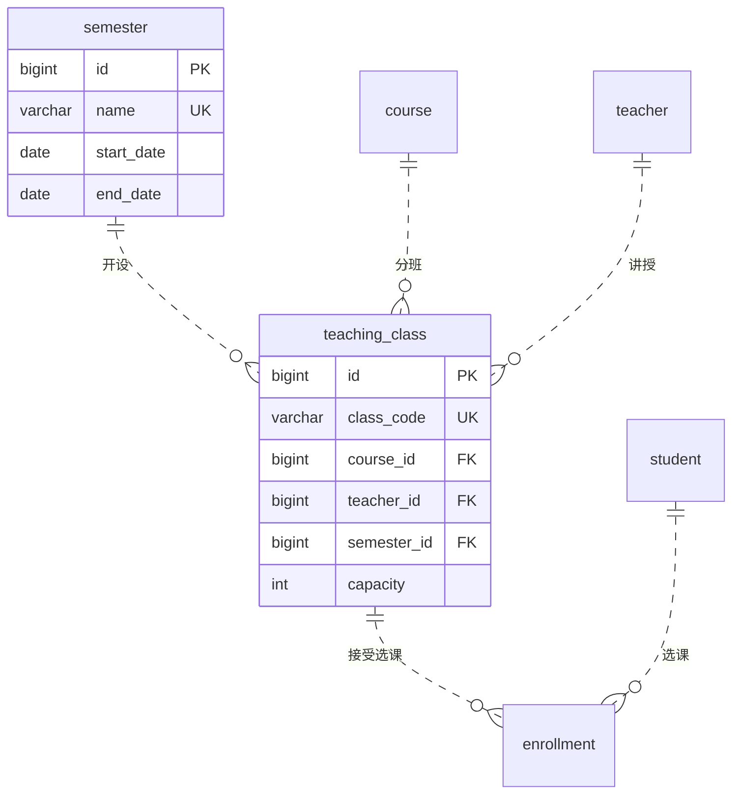

# 成员 C 概念设计：学期与教学班

学期描述一段教学时间，具有唯一的学期名称、开始日期和结束日期。教学班描述一门课程在某一学期的一次具体开设，具有唯一的班号、授课教师和容量。学生选择具体的教学班，因此同一门课程开出多个班时，各班有各自的名单和名额。

## 局部 E-R 图

C 维护 `semester` 和 `teaching_class`，图中列出这两个实体的全部属性。B 维护课程 `course` 和教师 `teacher`，A 维护学生 `student` 和选课记录 `enrollment`。图中的外部实体只展示与本模块相连的关系。跨模块部分按当前接口草案绘制，三方确认状态见接口文档。[C 模块接口契约](../../contracts/semester-teaching.md)

## 关系基数与外键

图中每条线左端的 `||` 表示恰好一个，右端的 `o{` 表示零到多个。例如，一名教师可以尚未开班，也可以讲授多个班；每个教学班必须有且仅有一名教师。各实体使用独立主键，虚线表示子记录通过外键关联父记录。

| 父实体 | 子实体 | 每条子记录引用的父键 |
|---|---|---|
| 学期 | 教学班 | `teaching_class.semester_id` → `semester.id` |
| 课程 | 教学班 | `teaching_class.course_id` → `course.id` |
| 教师 | 教学班 | `teaching_class.teacher_id` → `teacher.id` |
| 教学班 | 选课记录 | `enrollment.teaching_class_id` → `teaching_class.id` |
| 学生 | 选课记录 | `enrollment.student_id` → `student.id` |

学生与教学班的多对多关系由 `enrollment` 表达。同一学生和同一教学班保留一条选课关系。退课后记录仍关联该班，只有 `ENROLLED` 记录计入在选名单和人数。

## 同一课程如何开两个班

例如，学期 `1301` 的课程 `1201` 可以开设下列两个教学班。示例用于说明关系，具体种子由后续初始化脚本给出。

| 教学班 ID | 班号 | 学期 ID | 课程 ID | 教师 ID | 容量 |
|---|---|---|---|---|---|
| 2001 | DB-01 | 1301 | 1201 | 1101 | 30 |
| 2005 | DB-02 | 1301 | 1201 | 1101 | 25 |

两个班可以属于同一学期、同一课程，并由同一教师讲授。它们通过各自的 `id` 和 `class_code` 区分；学生选入 `2001` 时，选课只占用 `2001` 的名额。`(semester_id, course_id)` 因而可用于查出该课程的所有班，不能作为教学班的唯一标识。
